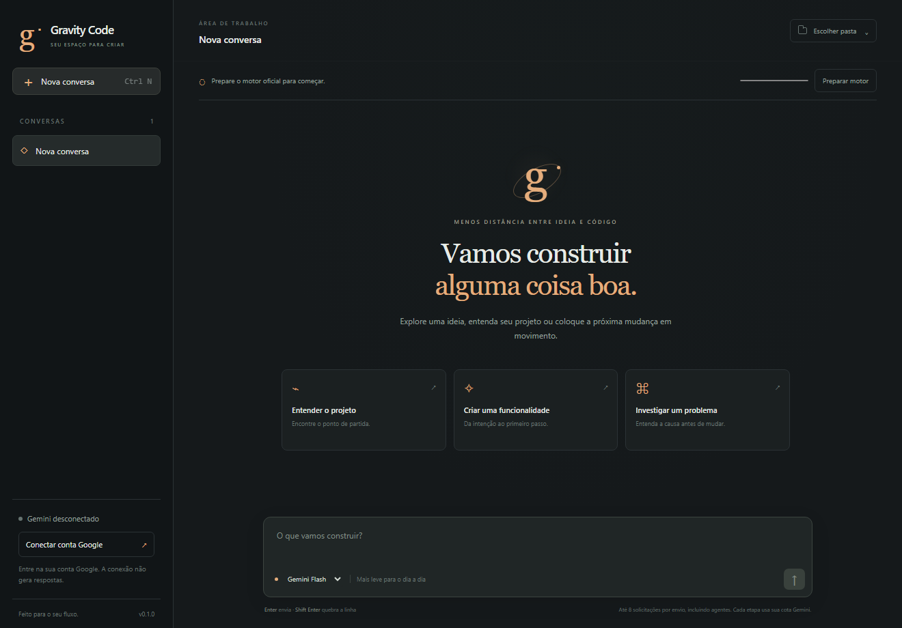

# Gravity Code

Aplicativo experimental independente para Windows x64: interface própria,
motor Claude Code e sessão Gemini conectada dentro do aplicativo.

**Prévia técnica.** Não é uma recompilação oficial do Claude Desktop. A análise
com REA orientou a reconstrução dos contratos; o código e os componentes
proprietários do Desktop não são redistribuídos.

## Usar no Windows

1. Baixe o ZIP na página [Releases](https://github.com/kayoinreality/gravity-code/releases).
2. Extraia a pasta inteira e abra `GravityCode.exe`.
3. Clique em **Preparar motor**. O aplicativo baixa o Claude Code 2.1.270 do
   servidor oficial da Anthropic e confere os hashes publicados no código.
4. Clique em **Conectar conta Google** e entre manualmente na página Google
   exibida dentro do aplicativo.
5. Escolha uma pasta de projeto, o modelo e envie sua mensagem.

Não é necessário instalar o Claude Desktop. O primeiro preparo requer internet
e aproximadamente 230 MB para o motor, além dos arquivos do aplicativo. O
executável desta prévia não tem assinatura digital do projeto.



## Modelos e consumo

- Flash é a seleção inicial; Argon pode ser escolhido por conversa quando
  estiver disponível no catálogo da conta. Não há troca silenciosa de modelo.
- A ferramenta nativa `Agent` pode delegar tarefas. `haiku` é roteado para
  Flash; `sonnet`/`opus` seguem o modelo principal selecionado. Isso usa a mesma
  cota Gemini da conta.
- Abrir o aplicativo ou validar o catálogo não gera texto. Não há geração de
  sugestões automática, importação automática de cookies de outros aplicativos
  ou carregamento de MCPs e plugins pessoais.
- Cada envio permite no máximo **8 chamadas ao modelo**, compartilhadas com
  agentes. Esse limite conta solicitações, não tokens nem porcentagem do plano.
- As instruções do motor, os esquemas das ferramentas e o histórico são enviados
  ao Gemini a cada etapa. Tarefas com ferramentas podem gastar bem mais que uma
  pergunta no site. A estimativa local não representa a medição do Google.

## Permissões e dados

O motor usa permissões manuais e modo restrito às pastas de trabalho. Alterações
e comandos que exigirem aprovação aparecem na conversa, com opções de permitir
ou recusar. Leia a ação antes de aprovar: comandos aprovados executam com os
privilégios do seu usuário.

A sessão Google fica no perfil Electron separado
`%LOCALAPPDATA%\GravityCodeStandalone`. Os cookies não são expostos à interface;
o motor recebe a sessão em memória por canal local com um segredo aleatório,
removido do ambiente antes de executar ferramentas. Conversas, contextos e
resultados de ferramentas são salvos localmente nesse perfil e enviados ao
Gemini quando usados em uma solicitação. Para sair da conta nesta prévia, feche
o aplicativo e remova a subpasta `Partitions\gravity-google` desse perfil.

## Limitações e validação

A integração usa o protocolo web do Gemini e pode parar se ele mudar. Chamadas
de ferramentas são traduzidas de JSON gerado pelo modelo; respostas fora do
formato falham antes da execução. Ainda não há suporte a imagens, anexos,
streaming progressivo de texto, sincronização de conta ou atualizações
automáticas.

O motor real foi verificado localmente com respostas simuladas, incluindo
aprovação de escrita. O adaptador Google foi validado em um protótipo anterior;
esta montagem independente ainda precisa de uma geração real depois que a cota
da conta for restabelecida. Consulte [validação](docs/validation.md) e
[achados do REA](docs/rea-findings.md).

## Desenvolver

Node.js 24 ou superior e Windows x64 para o empacotamento:

```text
npm ci
npm test
npm run verify:public
npm start
npm run build:windows
```

A licença MIT cobre o código original deste repositório. Consulte
[componentes e termos separados](THIRD_PARTY_NOTICES.md).
